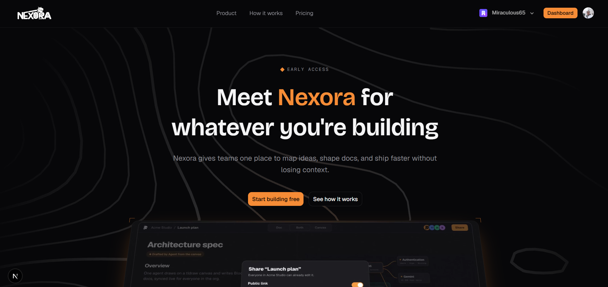

<div align="center">
 
## Nexora Demo

[](https://youtu.be/-Nt5kAfVYVs)

▶️ **[Watch Demo Video on Youtube](https://youtu.be/-Nt5kAfVYVs)**


### ** An AI Workspace for Canvas, Docs and Team Boards.**

*an AI workspace where you describe what you're building and an agent draws it for you. It maps your idea onto an infinite canvas and turns the diagram into a written spec. Your team can then work on it together in real time.*

<br/># Nexora

Nexora is a collaborative workspace for product teams, founders and agencies. Every workspace combines an infinite whiteboard and a block-based document editor, and a Gemini-powered agent can edit both for you from a chat panel.

## Features

- **Canvas**: an infinite whiteboard built on tldraw, with a custom ERD entity-table shape (typed columns, PK/FK flags, relationship arrows).
- **Docs**: a block-based editor built on BlockNote, with real-time collaboration through Yjs.
- **AI agent**: describe what you want ("draw a login flow", "write a spec for this feature") and the agent creates or edits shapes, ERD tables and document blocks through tool calls.
- **Team board**: a drag-and-drop kanban of workspaces with the statuses Planning, In Progress, In Review and Done.
- **Teams and organizations**: personal workspaces and organization-scoped workspaces through Clerk.
- **Public sharing**: read-only share links by token (paid plans).
- **PDF export** of docs and canvases (paid plans).
- **Plans and usage limits**: Clerk Billing with monthly agent prompt quotas and workspace limits.
- Light and dark themes.

## Tech stack

| Area | Tools |
| --- | --- |
| Framework | Next.js 16 (App Router, Turbopack), React 19, TypeScript |
| Styling / UI | Tailwind CSS 4, shadcn/ui, Radix UI, lucide-react, sonner |
| Auth and billing | Clerk (`@clerk/nextjs`, Clerk Billing, Organizations) |
| Database | PostgreSQL (Supabase) with Prisma 7 and `@prisma/adapter-pg` |
| Realtime | Supabase Realtime broadcast, Yjs, y-prosemirror, `@tldraw/sync` |
| Editors | tldraw, BlockNote |
| AI | Vercel AI SDK (`ai`, `@ai-sdk/react`), Google Gemini (`@ai-sdk/google`), zod |
| Export | `@react-pdf/renderer`, `jspdf`, `@blocknote/xl-pdf-exporter` |

## Project structure

The app lives in the `nexora/` folder.

```
nexora/
├── app/
│   ├── page.tsx                  Landing page and pricing
│   ├── (main)/dashboard/         Dashboard with prompt box and recent workspaces
│   ├── (main)/workspaces/        Kanban team board
│   ├── (main)/workspace/[id]/    Canvas + doc editor + agent chat panel
│   ├── shared/[token]/           Public read-only view
│   └── api/agent/route.ts        Streaming agent endpoint
├── actions/                      Server actions (workspace, canvas, doc, usage, user sync)
├── components/                   App shell, editors, dialogs, EntityTable tldraw shape, shadcn/ui
├── hooks/                        Collaborative doc, agent chat, fetch helpers
├── lib/
│   ├── agent-tools.ts            Zod tool definitions for the agent
│   ├── agent-canvas.ts / agent-doc.ts   Tool handlers for canvas and doc
│   ├── billing.ts, plan-limits.ts       Entitlements and prompt usage
│   ├── workspace-access.ts       Access control for personal and org workspaces
│   ├── supabase-yjs-provider.tsx Yjs sync over Supabase Realtime
│   └── prisma.ts                 Prisma client singleton
├── prisma/                       Schema and migrations
└── proxy.ts                      Clerk middleware (route protection)
```

## How the agent works

1. The chat panel sends the conversation plus a fresh summary of the canvas and doc to `POST /api/agent`.
2. The route authenticates the user, checks workspace access, and checks the owner's monthly prompt quota. If the quota is used up it returns `402` before calling the model.
3. `streamText` calls Gemini with a system prompt and the current canvas and doc state, and streams the response back, including reasoning.
4. The model calls tools (canvas shapes, ERD tables, doc blocks) and the client applies them to the live editors.
5. A prompt is recorded in `AgentPrompt` only after Gemini answers, so failed requests are not charged.

Available tools: `createRectangle`, `createEllipse`, `createText`, `createArrow`, `updateShape`, `deleteShape`, `createEntityTable`, `addColumn`, `updateColumn`, `removeColumn`, `connectRelationship`, `insertDocContent`, `updateDocBlock`, `deleteDocBlocks`, `replaceDoc`.

## Data model

- **User**: synced from Clerk (`clerkId`).
- **Workspace**: name, description, status, kanban `position`, optional `clerkOrgId`, optional `shareToken`.
- **Doc**: JSON content and Yjs state, one per workspace.
- **Canvas**: JSON content, one per workspace.
- **AgentPrompt**: one row per charged prompt, used to count monthly usage per owner (user or organization).

## Plans and limits

| | Free | Paid |
| --- | --- | --- |
| Workspaces | 3 | Unlimited (`unlimited_workspaces`) |
| Agent prompts per month | 20 | 500 or 2000 per member (`agent_prompts_500`, `agent_prompts_2000`) |
| Public sharing | No | `public_sharing` |
| PDF export | No | `pdf_export` |

Create matching plans and feature slugs in the Clerk dashboard.

## Getting started

### Prerequisites

- Node.js 20 or later
- A PostgreSQL database (Supabase works well)
- A Clerk application with Organizations and Billing enabled
- A Supabase project (for Realtime)
- A Google Gemini API key

### Setup

```bash
cd nexora
npm install          # also runs `prisma generate`
```

Create `nexora/.env`:

```env
# Clerk
NEXT_PUBLIC_CLERK_PUBLISHABLE_KEY=
CLERK_SECRET_KEY=

# Database
DATABASE_URL=        # pooled connection
DIRECT_URL=          # direct/session connection, used for migrations

# Supabase Realtime
NEXT_PUBLIC_SUPABASE_URL=
NEXT_PUBLIC_SUPABASE_PUBLISHABLE_KEY=

# Gemini
GOOGLE_GENERATIVE_AI_API_KEY=
```

Apply the database migrations and start the dev server:

```bash
npx prisma migrate deploy
npm run dev
```

Open http://localhost:3000.

### Scripts

| Command | Description |
| --- | --- |
| `npm run dev` | Start the dev server |
| `npm run build` | Create a production build |
| `npm run start` | Run the production build |
| `npm run lint` | Run ESLint |

## Access control

`proxy.ts` protects `/dashboard`, `/workspace` and `/workspaces` with Clerk. `/shared/*` is public. Personal workspaces are visible to their creator. Organization workspaces are visible to members of that organization, and the creator or an org admin can delete them.

## Notes

- This project uses a recent Next.js version with breaking changes. Check `node_modules/next/dist/docs/` before changing framework-level code.
- Never commit `.env`.

## License

See [LICENSE](./LICENSE).
